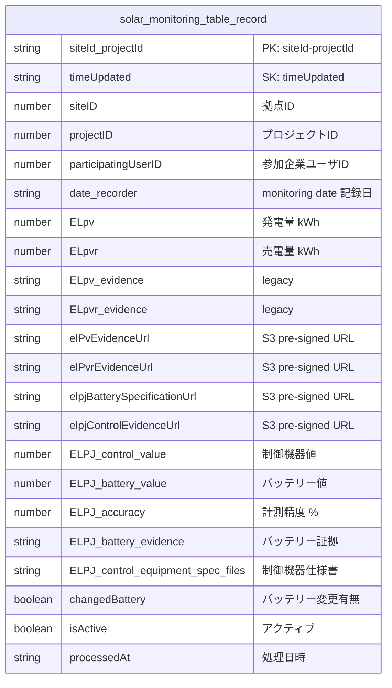
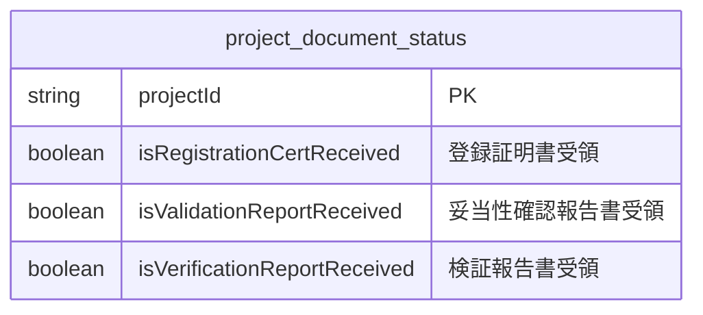
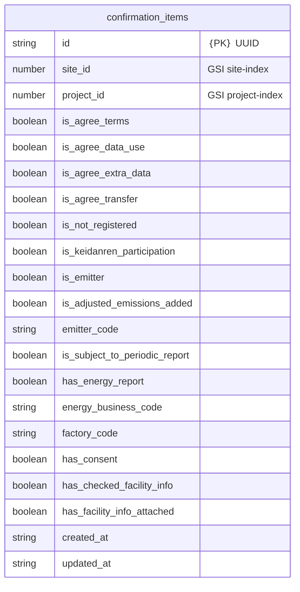

dynamoDB

table: `project_document_status`

table: `confirmation_items` 

---

| SQL  | カルム |   |
|-----------|--------|---------------------|
| `record_cancel_request` | `record_pk` | → `solar_monitoring_table_record.PK` |
| `record_cancel_request` | `record_sk` | → `solar_monitoring_table_record.SK` |

---

